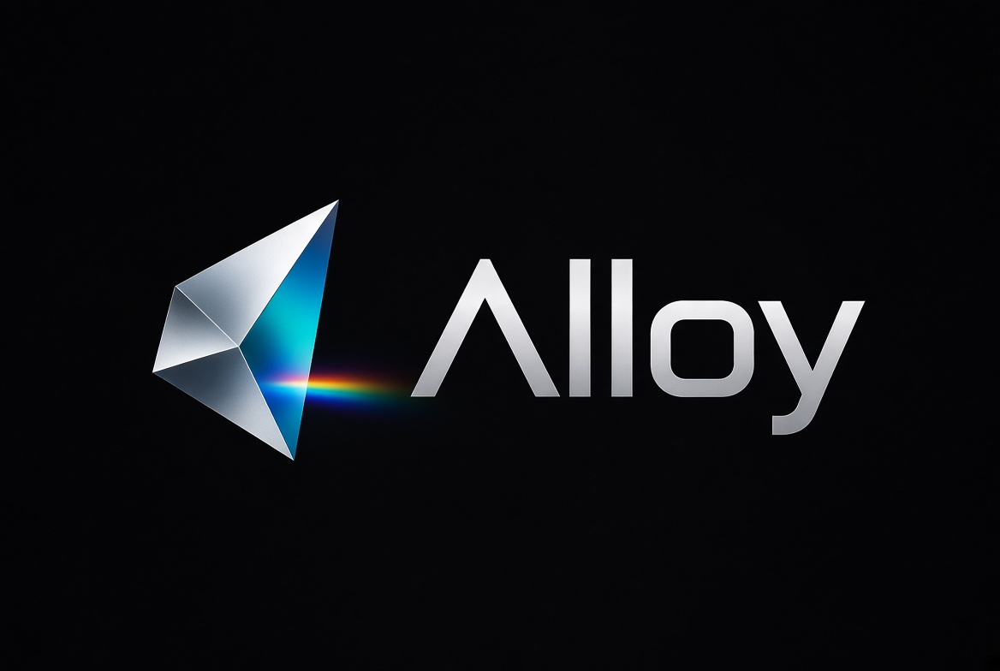

<p align="center">
  
</p>

<h1 align="center">Alloy v0.2</h1>

<p align="center">
  A small systems language designed for LLMs.
</p>

In v0.2 it becomes a real, runnable compiler where the compilation passes are
performed by an LLM through a structured JSON protocol (ACP).

| File | Role |
|------|------|
| `SPEC.md` | Language law + Alloy IR + ACP integration. |
| `LLM_SYSTEM.md` | System prompt for models that **write** Alloy code. |
| `COMPILER_SYSTEM.md` | System prompt for models that **compile** Alloy code. |
| `ACP_SCHEMA.json` | JSON Schema for Alloy Compilation Protocol requests/responses. |
| `docs/ACP.md` | Full ACP protocol documentation. |
| `cli/alloy` | Reference CLI. |
| `mcp/mcp_server.py` | Optional MCP server. |
| `examples/hello/` | Canonical package. |
| `examples/hanoi/` | Recursive Towers of Hanoi demo. |

## Quick start

```bash
# 1. Make sure a local model is reachable. Ollama is the default.
ollama run qwen2.5:0.5b

# 2. Build the canonical hello example.
./cli/alloy run examples/hello
# -> Hello, world!

# 3. Or just type-check it.
./cli/alloy check examples/hello
```

## Compiling the examples

Both examples compile with the same command:

```bash
./cli/alloy run examples/hello
./cli/alloy run examples/hanoi
```

`hello` works with small models such as `qwen2.5:0.5b`. `hanoi` uses recursion
and string formatting, so a larger model is recommended; the example is
tested with `qwen3:4b` (set in `examples/hanoi/alloy.toml`).

Expected Hanoi output for 4 disks:

```
Move from A to B
Move from A to C
Move from B to C
Move from A to B
Move from C to A
Move from C to B
Move from A to B
Move from A to C
Move from B to C
Move from B to A
Move from C to A
Move from B to C
Move from A to B
Move from A to C
Move from B to C
```

## Installation

No build step is required for the reference CLI; it is pure Python 3.11+.

```bash
chmod +x cli/alloy
# Optional: add to PATH
ln -s "$(pwd)/cli/alloy" ~/.local/bin/alloy
```

## CLI usage

```bash
alloy init [dir]                       # create alloy.toml + src/main.al
alloy check [path]                     # type-check via LLM
alloy build [--target TRIPLE]          # compile to target/
            [--emit {ir,assembly,c,wasm,object}]
            [--opt N]
            [path]
alloy run [path]                       # build and execute
```

Example:

```bash
alloy build examples/hello --target x86_64-unknown-linux-gnu --emit c
```

This sends the full package text to the configured LLM, receives an ACP JSON
response, writes the emitted artifact (e.g. `hello.c`) to
`target/x86_64_unknown_linux_gnu/`, and compiles it to a native binary.

## Configuration

`alloy.toml` can contain a `[compiler]` section:

```toml
[package]
name = "hello"
version = "0.2.0"
kind = "bin"

[compiler]
provider = "ollama"
model = "qwen2.5:0.5b"
base_url = "http://localhost:11434/v1"
# api_key = "sk-..."   # only needed for remote providers
```

Priority (highest first):

1. CLI flags: `--provider`, `--model`, `--base-url`, `--api-key`
2. `alloy.toml` `[compiler]` section
3. Environment variables:
   - `ALLOY_PROVIDER`
   - `ALLOY_MODEL`
   - `ALLOY_BASE_URL`
   - `ALLOY_API_KEY`
4. Built-in defaults (Ollama, `qwen2.5-coder:7b`, `http://localhost:11434/v1`)

### Provider examples

**Ollama (local)**

```toml
[compiler]
provider = "ollama"
model = "qwen2.5:0.5b"
base_url = "http://localhost:11434/v1"
```

**OpenAI / GPT**

```toml
[compiler]
provider = "openai"
model = "gpt-4o-mini"
base_url = "https://api.openai.com/v1"
api_key = "sk-..."
```

**Any OpenAI-compatible endpoint** (Groq, DeepSeek, local llama.cpp server, etc.)

```toml
[compiler]
provider = "generic"
model = "llama-3.1-8b"
base_url = "https://api.groq.com/openai/v1"
api_key = "gsk_..."
```

The CLI uses the standard `/v1/chat/completions` endpoint.

## Alloy Compilation Protocol (ACP)

ACP is a JSON request/response protocol between the CLI and a compiler LLM.
The CLI reads `alloy.toml` and every `.al` file under `src/`, builds an ACP
request, and asks the model to return diagnostics, Alloy IR, and artifacts.

See `docs/ACP.md` and `ACP_SCHEMA.json` for the full specification.

## MCP server

A lightweight MCP server is provided in `mcp/mcp_server.py`. It exposes three
tools over stdio JSON-RPC:

- `alloy_check`
- `alloy_compile`
- `alloy_emit`

Run it with:

```bash
python3 mcp/mcp_server.py
```

Then any MCP-aware agent can compile Alloy packages through the same ACP
protocol.

## Tests

```bash
python3 -m unittest discover -s cli/tests -v
```

Tests include:

- ACP schema validation
- Mock LLM integration (fixed JSON response -> files written correctly)
- End-to-end check against the local Qwen model if `OLLAMA_TEST_MODEL` is set.

## Language status

- v0.1 syntax is fully preserved.
- v0.2 adds Alloy IR (§17) and ACP (§18).
- The compiler is real but LLM-powered; emitted C/assembly quality depends on
the configured model.
